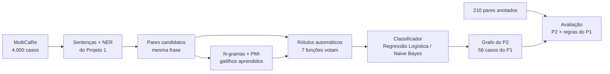
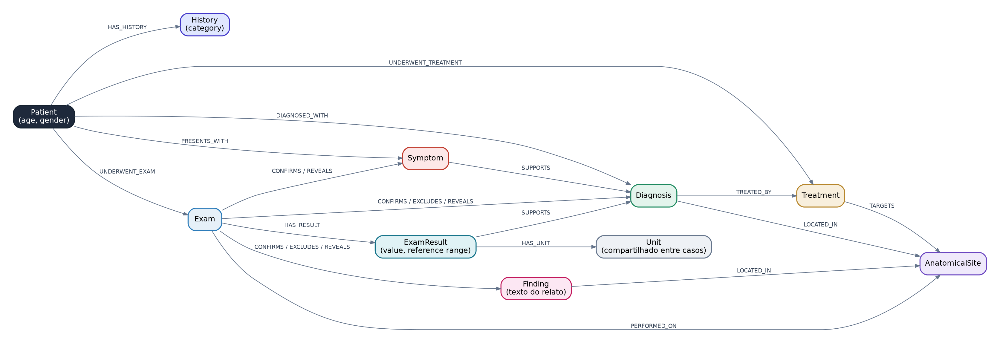
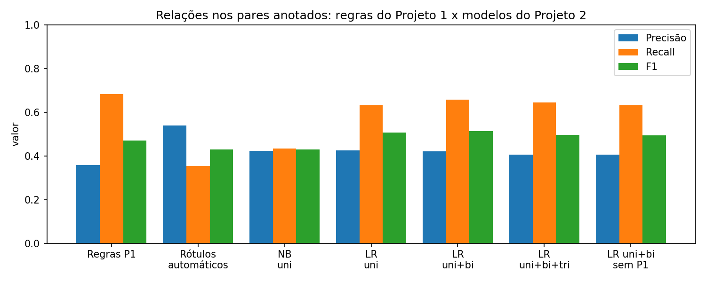
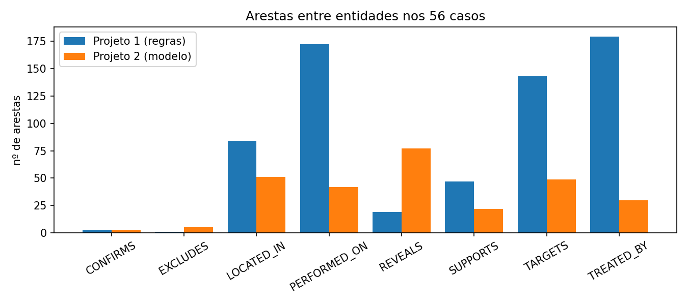
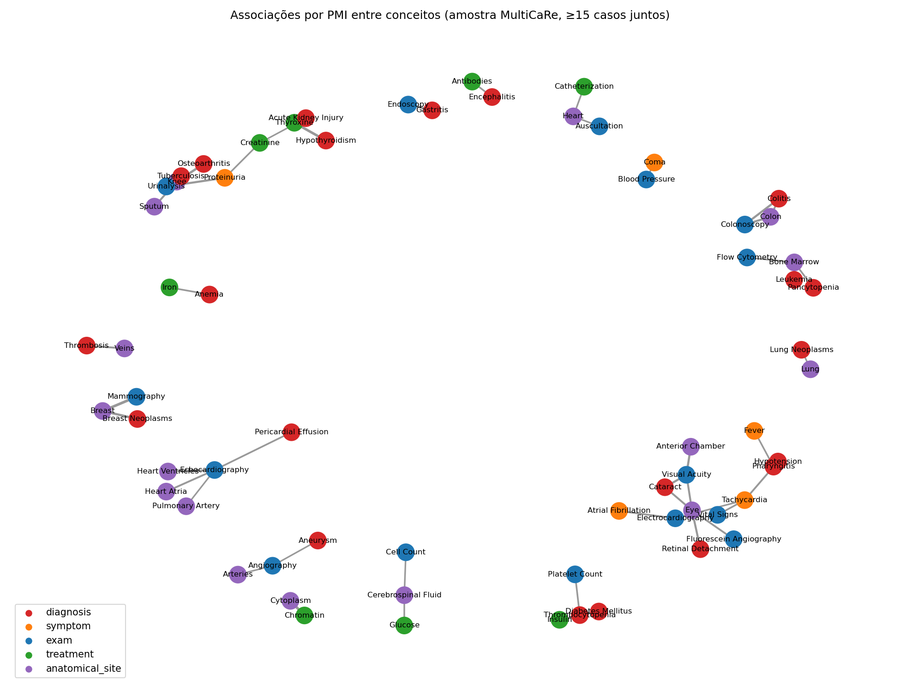

# Projeto `Relações Clínicas Aprendidas com N-gramas e Aprendizado de Máquina Clássico`
# Project `Learning Clinical Relations with N-grams and Classical Machine Learning`

| Nome | RA |
|---|---|
| Mateus Farha | 252678 |
| Lucas Lembo | 254467 |
| Gustavo Rodrigues | 238183 |
| Gabriela Coppo | 167163 |
| João Azeredo | 288818 |

## Slides

[Apresentação (PDF)](assets/slides/apresentacao.pdf)

## Demonstração Executável

[Notebook de demonstração](pipelines/notebooks/demo.ipynb) ([abrir no Colab](https://colab.research.google.com/github/<usuario>/<repo>/blob/main/project2/pipelines/notebooks/demo.ipynb))

O notebook carrega os resultados já calculados pelo pipeline e roda em segundos, sem baixar o MultiCaRe nem rodar o NER. Ele mostra:

- os gatilhos aprendidos por PMI, ao lado dos gatilhos manuais do Projeto 1;
- as métricas de regras × modelos;
- o classificador aplicado a frases digitadas;
- o grafo de um caso nas duas versões;
- o grafo de associação entre conceitos.

### Visualizador P1 × P2

[Comparador de grafos](assets/graph_viewer/index.html) ([abrir no navegador](https://htmlpreview.github.io/?https://github.com/lucas-lembo/NLP-Projeto2/blob/main/assets/graph_viewer/index.html)): uma página HTML única, feita com Cytoscape.js, que mostra o grafo de cada um dos 56 casos nas duas versões. Os nós são os mesmos nos dois grafos, então as arestas podem ser comparadas uma a uma. É possível:

- ver os grafos **lado a lado**, só o P1, só o P2 ou no **modo diferença**, que colore as arestas que só o P1 criou, as que só o P2 criou e as que mudaram de relação;
- usar um **limiar de probabilidade** para esconder as arestas do P2 com confiança baixa e ver o grafo mudar;
- clicar numa aresta para ver a **frase de origem**, a probabilidade dada pelo classificador e o **PMI do par no corpus**, ou seja, a camada de associação servindo de segunda evidência;
- ler o texto do caso e as tabelas de comparação do caso e do conjunto todo.

O visualizador é gerado por [`build_viewer.py`](src/kg_ml/build_viewer.py) a partir dos mesmos CSVs do relatório.

## Metodologia

O [Projeto 1](https://github.com/jrsbr/NLP-Projeto1) extraía o grafo só com regras. O NER por dicionário (MeSH) funcionava razoavelmente. A parte fraca eram as **relações entre entidades**: duas entidades na mesma frase viravam aresta por co-ocorrência, e o tipo da relação vinha de uma lista de gatilhos escrita à mão. No próprio relatório do P1, apontamos três consequências:

- `Asthma TREATED_BY Heparin`, porque o tratamento era ligado ao último diagnóstico visto;
- 28% das arestas eram pura proximidade anatômica no texto;
- nenhuma aresta tinha grau de confiança.

No Projeto 2, mantivemos a segmentação de sentenças e o NER do P1 e trocamos a etapa de relações por um **classificador treinado com atributos de N-gramas**. Para isso, aprendemos padrões com estatística em um corpus 70 vezes maior. Não usamos LLM, embeddings nem Transformers em nenhuma etapa da extração.

O código do P1 é importado como biblioteca, sem nenhuma alteração. O pipeline do P2 está em [`src/kg_ml/`](src/kg_ml/), com [instruções de execução](src/README.md), e roda inteiro em cerca de 4 minutos.

### 1. Corpus maior e pares candidatos

Os 56 casos do P1 são poucos para estimar estatística de N-gramas. Baixamos o `cases.parquet` do MultiCaRe (versão 3.0.1, 98.641 casos) e sorteamos **4.000 casos**, excluindo os 50 artigos do P1. Os 56 casos originais ficaram reservados só para a avaliação, então nada deles entra no treino.

Em cada caso, rodamos a segmentação e o NER do P1. Na amostra de treino usamos só a busca exata (Aho-Corasick): a busca tolerante do P1 levaria horas nesse volume. Nos 56 casos de teste usamos o NER completo, para os nós saírem idênticos aos do grafo do P1.

Um **par candidato** é qualquer dupla de entidades na mesma sentença cujos tipos podem se relacionar, com no máximo 30 tokens entre elas. São 7 tipos de par, com as mesmas relações do P1:

| Par (origem → destino) | Relações possíveis |
|---|---|
| `Diagnosis` → `Treatment` | `TREATED_BY` |
| `Symptom` → `Diagnosis` | `SUPPORTS` |
| `Diagnosis` → `AnatomicalSite` | `LOCATED_IN` |
| `Treatment` → `AnatomicalSite` | `TARGETS` |
| `Exam` → `AnatomicalSite` | `PERFORMED_ON` |
| `Exam` → `Diagnosis` / `Symptom` | `CONFIRMS`, `EXCLUDES`, `REVEALS` |

Todo par também pode receber `NONE`, ou seja, "não há relação". Essa é a diferença principal para o P1, onde a co-ocorrência dizia "sim" para todo par na mesma frase. Para cada par, guardamos o texto entre as entidades, 3 palavras de contexto de cada lado e o que as regras do P1 teriam decidido (`p1_label`). Isso permite comparar os dois projetos par a par.

O resultado são **39.596 pares de treino** e **636 pares de teste** (52 dos 56 casos têm pelo menos um par).

### 2. N-gramas + PMI: gatilhos aprendidos

No P1, os gatilhos (`treated with`, `revealed`...) foram escritos à mão. Aqui eles são **descobertos do corpus**: para cada tipo de par `T`, procuramos os N-gramas `g` (1 a 3 palavras) que aparecem entre as duas entidades com mais frequência do que entre pares em geral. A medida é a informação mútua pontual (PMI):

$$
\mathrm{PMI}(g, T) = \log_2 \frac{P(g \mid T)}{P(g)}
$$

~~~python
p_g_given_t = c / count_type[pair_type]
p_g = count_gram[g] / total
pmi = math.log2(p_g_given_t / p_g)
~~~

Para reduzir ruído, só contamos pares com até 8 tokens entre as entidades, porque a relação costuma estar perto. Também exigimos pelo menos 20 ocorrências e descartamos N-gramas formados só por stopwords, números ou pedaços de unidade (`g/dL` vira `g dl` na tokenização). Os 25 N-gramas de maior PMI de cada tipo de par viram os **gatilhos aprendidos** ([`learned_patterns.csv`](data/processed/learned_patterns.csv)).

O mesmo PMI, aplicado a **conceitos que aparecem no mesmo caso** (ex.: `Hypothyroidism` e `Thyroxine`), gera uma segunda camada: um grafo de associação com o "conhecimento" do corpus ([`concept_pmi.csv`](data/processed/concept_pmi.csv)). Essa camada não diz o que uma frase afirma; diz quais conceitos andam juntos nos relatos.

### 3. Rótulos automáticos (weak supervision)

Para treinar um classificador, é preciso ter pares rotulados, e anotar milhares à mão seria inviável. Usamos **weak supervision** (supervisão fraca). Várias funções simples votam no rótulo de cada par, e cada uma pode se abster:

| Função | Vota | Quando |
|---|---|---|
| `lf_p1_trigger` | a relação (com a polaridade do P1) | um gatilho do `triggers.csv` está entre as entidades |
| `lf_learned_pattern` | a relação | um gatilho aprendido por PMI está entre as entidades |
| `lf_adjacent` | a relação | as entidades estão coladas (até 2 tokens, sem vírgula): *"lung adenocarcinoma"* |
| `lf_far` | `NONE` | mais de 15 tokens entre as entidades |
| `lf_separator` | `NONE` | `;`, `but`, `whereas` ou `however` entre elas |
| `lf_entity_between` | `NONE` | outra entidade do mesmo tipo no meio, então a relação provavelmente é com ela |
| `lf_negation` | `EXCLUDES` | `no`, `without`, `negative`... logo antes do diagnóstico, depois de um exame |

~~~python
def lf_entity_between(self, row):
    # outra entidade do mesmo tipo no meio: a relação provavelmente é com ela
    for s, e, etype in self.entity_spans.get((row.case_id, row.sent_idx), []):
        if s >= start and e <= end and etype in (row.e1_type, row.e2_type):
            return NONE_LABEL
    return None
~~~

O rótulo final é o voto da maioria; pares sem voto ou com empate são descartados. Assim, 22.758 dos 39.596 pares (57%) ficaram rotulados, sendo 13.739 como `NONE`. A regra "último diagnóstico visto" do P1 ficou de fora de propósito, para o modelo não aprender um defeito que já conhecíamos.

| Função | Cobertura | Conflito com outras |
|---|---:|---:|
| `lf_p1_trigger` | 6,7% | 49% |
| `lf_learned_pattern` | 23,5% | 59% |
| `lf_adjacent` | 11,9% | 2% |
| `lf_far` | 19,8% | 32% |
| `lf_separator` | 6,1% | 26% |
| `lf_entity_between` | 35,4% | 32% |
| `lf_negation` | 0,7% | 77% |

O conflito alto é esperado: as funções de relação e as de `NONE` olham coisas diferentes do mesmo par, e a votação existe justamente para resolver isso. Para o **teste sem os gatilhos do P1**, refizemos a votação sem `lf_p1_trigger` (`weak_label_no_p1`) e treinamos outro modelo com esses rótulos. Isso mede quanto o modelo depende das regras do P1.

### 4. Classificador de relações

Cada par vira um vetor de atributos:

- **N-gramas do texto entre as entidades**, ponderados por TF-IDF, com pontuação mantida como token (`,` `;` `(`);
- **3 palavras de contexto** antes e depois do par (`L_` e `R_`);
- **tipo do par, ordem das entidades e faixa de distância** (0–2, 3–5, 6–10, 11+ tokens).

~~~python
features = ColumnTransformer([
    ("between", TfidfVectorizer(ngram_range=(1, ngram_max), token_pattern=r"\S+", min_df=3), "between"),
    ("context", CountVectorizer(token_pattern=r"\S+", min_df=3, binary=True), "context"),
    ("meta", OneHotEncoder(handle_unknown="ignore"), ["pair_type", "order", "distance"]),
])
~~~

Comparamos **Regressão Logística** (com `class_weight="balanced"`, porque `NONE` domina) e **Multinomial Naive Bayes**, cada um com unigramas, uni+bigramas e uni+bi+trigramas. Um único modelo multiclasse cobre todos os tipos de par. Na hora de prever, a escolha fica restrita às relações permitidas para aquele tipo, então um par diagnóstico–tratamento nunca recebe `LOCATED_IN`. A probabilidade `1 − P(NONE)` vira o grau de confiança da aresta.

### 5. Avaliação e montagem do grafo

Sorteamos **210 pares de teste** (30 por tipo de par) dos 56 casos do P1. Eles foram pré-anotados por um modelo de linguagem (ver [Como Modelos de Linguagem foram Usados](#como-modelos-de-linguagem-foram-usados)) e revisados pela equipe, seguindo um [guia de anotação](data/annotation/GUIA-ANOTACAO.md). Cada um dos 5 membros revisou 42 pares; o nome de quem revisou fica na coluna `reviewer` e as justificativas dos casos ambíguos, na coluna `notes`. O critério é o que **a frase afirma** sobre o paciente, não o que é verdade em medicina.
As métricas são precisão, recall e F1 das relações. Um acerto exige o rótulo exato, e prever `NONE` nunca conta como acerto. Também medimos a **detecção** (só "tem relação ou não") e reportamos tudo por tipo de par.

O grafo do P2 usa os **mesmos nós** do P1: o NER é o mesmo. Mantivemos as arestas do paciente, histórico, resultados de exame, unidades e achados, e trocamos só as arestas entre entidades pelas previsões do classificador (uni+bigramas). Quando o mesmo par de nós aparece em várias frases, fica a menção de maior probabilidade.

### Confronto com Trabalho Anterior

| Aspecto | Projeto 1 | Projeto 2 |
|---|---|---|
| Ligação entre entidades | co-ocorrência na frase: todo par vira aresta | classificador decide entre a relação e `NONE` |
| Tipo e polaridade da relação | 31 gatilhos escritos à mão | gatilhos aprendidos por PMI + pesos aprendidos dos N-gramas |
| `TREATED_BY` | tratamento ligado ao último diagnóstico visto, mesmo em outra frase | decidido pelo contexto da frase |
| Confiança da aresta | nenhuma | `prob` em `attributes` |
| Dados usados | 56 casos | 4.000 casos para aprender, 56 para avaliar |
| Avaliação | qualitativa | 210 pares anotados, P/R/F1 |

Nos 210 pares anotados, a Regressão Logística com uni+bigramas teve **F1 de 0,51, contra 0,47 das regras do P1**. A precisão foi de 0,42 contra 0,36, ou seja, o modelo cria menos arestas falsas. Essa precisão ainda é baixa: mais da metade das relações previstas está errada.

O ganho não é uniforme entre os tipos de par:

- **Melhora** onde o P1 era co-ocorrência pura (`LOCATED_IN`, `SUPPORTS`, `TARGETS`), porque o modelo consegue dizer `NONE`.
- **Melhora** em exame → diagnóstico, onde o P1 quase nunca disparava.
- **Piora** em `PERFORMED_ON` e `TREATED_BY` na mesma frase, onde a regra do P1 já acertava bastante. Os detalhes estão em [Resultados](#resultados).

O exemplo do P1 que motivou o projeto mudou. No caso `PMC7102447_01`, a frase *"the patient was started immediately on heparin infusion for suspicion of acute coronary syndrome"* gerava `Asthma TREATED_BY Heparin` no P1. No P2, gera `Acute Coronary Syndrome TREATED_BY Heparin` (probabilidade 0,78). Mas ainda há erros parecidos: a demonstração mostra uma frase em que `received` faz o modelo ligar o heparin à asma, quando ele foi dado para a trombose.

## Trabalhos Estudados

- **MultiCaRe** (Nievas Offidani et al., 2025): artigo do dataset, já estudado no P1. Aqui, usamos a versão completa no Zenodo para montar a amostra de treino.
- **Snorkel** (Ratner et al., 2017): base da etapa de rótulos automáticos. Dele vêm a ideia de funções de rotulagem que podem se abster, a combinação por votação e a análise de cobertura e conflito de cada função. Usamos o voto da maioria em vez do modelo generativo do Snorkel, por simplicidade.
- **Distant supervision** (Mintz et al., 2009): a ideia de treinar um extrator de relações com rótulos gerados automaticamente, aceitando ruído em troca de volume.
- **Padrões léxicos para relações** (Hearst, 1992): a ideia de que expressões curtas entre duas entidades ("such as", "treated with") revelam a relação. É o que o PMI procura de forma automática.
- **PMI** (Church & Hanks, 1990): medida de associação entre palavras usada nos gatilhos aprendidos e no grafo de associação.
- **Jurafsky & Martin, *Speech and Language Processing***: capítulos de N-gramas, Naive Bayes, Regressão Logística e extração de informação, junto com os slides da disciplina.

## Modelo Lógico

O modelo lógico é o mesmo do P1: 10 tipos de nó e 15 relações, salvos em [`nodes.csv`](data/processed/nodes.csv) e [`edges.csv`](data/processed/edges.csv) no esquema do enunciado. A diferença está nas arestas entre entidades (`TREATED_BY`, `SUPPORTS`, `LOCATED_IN`, `TARGETS`, `PERFORMED_ON`, `CONFIRMS`, `EXCLUDES`, `REVEALS`): agora elas carregam `prob=<valor>` em `attributes`, a probabilidade dada pelo classificador.

A camada de associação ([`concept_pmi.csv`](data/processed/concept_pmi.csv)) fica separada do grafo por caso. Ela liga conceitos, não instâncias de um paciente, e cada aresta tem o número de casos em que os dois aparecem juntos e o PMI.

## Análises que podem ser realizadas

- **Filtrar o grafo por confiança:** como cada aresta tem `prob`, dá para escolher o ponto entre um grafo mais completo (limiar baixo) e um mais confiável (limiar alto). O limiar pode variar com o uso.
- **Validar relações por caso com a camada de associação:** uma aresta `TREATED_BY` extraída de uma frase, entre conceitos com PMI alto no corpus (`Diabetes Mellitus`–`Insulin`), é mais crível que uma entre conceitos sem associação.
- **Descobrir protocolos:** quais exames costumam `CONFIRMS` ou `REVEALS` cada diagnóstico, agregando os 56 casos (ou o corpus inteiro, rodando o classificador na amostra).
- **Auditar o vocabulário:** os N-gramas de PMI alto que são, na verdade, nomes de entidades (`hemoglobin`, `fever`) apontam termos que o gazetteer do P1 não reconhece.
- **Comparar fontes de relação:** para cada aresta, ver se as regras do P1 e o classificador concordam; as discordâncias são os casos interessantes para revisão.

## Ferramentas

- **Python + pandas**: todo o pipeline, além do código do Projeto 1 (`kg_extraction`), reaproveitado como biblioteca para sentenças, NER, gatilhos e valor+unidade.
- **scikit-learn**: TF-IDF, Regressão Logística, Naive Bayes e métricas. Escolhemos modelos lineares porque permitem ler os pesos de cada N-grama ([`top_features.csv`](data/processed/top_features.csv)) e explicar a decisão.
- **Contagens próprias** (`collections.Counter`) para N-gramas e PMI. É pouco código e deixa a fórmula visível.
- **pyarrow + requests**: leitura do `cases.parquet` e download do Zenodo.
- **matplotlib + networkx**: figuras do relatório e desenho do grafo de associação.
- **Jupyter / Colab**: demonstração executável.
- **Estrutura do repositório**: [Cookiecutter Data Science](https://drivendata.github.io/cookiecutter-data-science/) simplificado, igual ao P1.

## Resultados

### Gatilhos aprendidos

O PMI recuperou os gatilhos centrais do P1 sem ter visto a lista. `started on` ficou em 1º lugar entre os padrões de diagnóstico–tratamento, `confirmed` em 1º em exame–diagnóstico, e `revealed`, `showed` e `demonstrated` entre os 12 primeiros de exame–diagnóstico e exame–sintoma. No total, 7 dos 23 gatilhos de exame e de administração do P1 aparecem entre os padrões com PMI positivo. Os que faltam, como `ruled out`, `no evidence of` e `prescribed`, aparecem menos de 20 vezes entre pares próximos na amostra ([`p1_triggers_vs_pmi.csv`](data/processed/p1_triggers_vs_pmi.csv)).

| Tipo de par | N-gramas de maior PMI |
|---|---|
| diagnóstico–tratamento | started on, was started on, with intravenous, was treated with, treated with |
| exame–local | ct of the, scan of the, ct of, mri of, of the abdomen |
| exame–diagnóstico | confirmed, diagnosis of, was performed, demonstrated, revealed |
| exame–sintoma | ecg, sinus, revealed, showed, demonstrated |
| diagnóstico–local | involving the, involving, biopsy, consistent with, metastatic |
| sintoma–diagnóstico | chronic kidney, obstructive, failure, fever, secondary to |

O PMI também acha padrões novos (`involving` para localização, `secondary to` para sintoma–diagnóstico) e mostra ruído. Em sintoma–diagnóstico, boa parte dos N-gramas são nomes de outras doenças que o NER não reconheceu.

### Regras do P1 × modelos

| Sistema | Precisão | Recall | F1 | F1 detecção |
|---|---:|---:|---:|---:|
| Regras do P1 | 0,36 | 0,68 | 0,47 | 0,49 |
| Rótulos automáticos aplicados direto | 0,54 | 0,36 | 0,43 | 0,48 |
| Naive Bayes, unigramas | 0,42 | 0,43 | 0,43 | 0,55 |
| Regressão Logística, unigramas | 0,43 | 0,63 | 0,51 | 0,59 |
| **Regressão Logística, uni+bigramas** | **0,42** | **0,66** | **0,51** | **0,59** |
| Regressão Logística, uni+bi+trigramas | 0,41 | 0,65 | 0,50 | 0,58 |
| Regressão Logística, uni+bigramas, sem gatilhos do P1 | 0,41 | 0,63 | 0,50 | 0,60 |

O que a tabela mostra:

- **O classificador generaliza além dos próprios rótulos.** Aplicadas direto no teste, as funções de rotulagem têm recall de só 0,36, porque se abstêm muito. O classificador treinado com elas chega a 0,66: ele aprende combinações de N-gramas que nenhuma função sozinha cobre.
- **Mais N-gramas não ajudam.** Unigramas e uni+bigramas empatam, e trigramas pioram um pouco. Com 22 mil pares de treino, trigramas são raros demais para ganhar peso.
- **Naive Bayes fica bem atrás.** Ele é mais conservador (prevê menos relações) e perde recall a cada N-grama acrescentado.
- **O modelo não está só copiando as regras do P1.** Sem os gatilhos do P1 nos rótulos, o F1 cai só de 0,51 para 0,50. A exceção é `CONFIRMS`: nenhuma outra função vota nessa classe, então o modelo treinado sem os gatilhos do P1 nunca a prevê.

Os pesos da Regressão Logística ([`top_features.csv`](data/processed/top_features.csv)) são legíveis:

- `EXCLUDES` é puxado por `negative for`, `no`, `excluded`, `without`;
- `CONFIRMS`, por `suggestive of`, `consistent with`, `positive for`;
- `NONE`, por `,`, `;`, `but` e distância acima de 11 tokens.

Por tipo de par (F1):

| Tipo de par | Regras do P1 | Regressão Logística |
|---|---:|---:|
| diagnóstico–local | 0,50 | 0,55 |
| diagnóstico–tratamento | 0,70 | 0,65 |
| exame–local | 0,64 | 0,35 |
| exame–diagnóstico | 0,30 | 0,49 |
| exame–sintoma | 0,58 | 0,61 |
| sintoma–diagnóstico | 0,33 | 0,38 |
| tratamento–local | 0,24 | 0,29 |

A maior perda é em exame–local (`PERFORMED_ON`), com recall de 0,21. Os rótulos automáticos só marcam essa relação quando exame e local estão colados (*"abdominal CT"*). Por isso o modelo não aprendeu casos como *"computed tomography, demonstrating a lesion ... of the pancreas"*. É um limite da supervisão fraca: o modelo herda os pontos cegos das funções que o rotularam.

Matriz de confusão da Regressão Logística com uni+bigramas nos 210 pares (linhas: rótulo anotado; colunas: previsão; [`confusion_logreg_ngram2.csv`](data/processed/confusion_logreg_ngram2.csv)):

| Anotado ↓ / Previsto → | CONFIRMS | EXCLUDES | LOCATED_IN | NONE | PERFORMED_ON | REVEALS | SUPPORTS | TARGETS | TREATED_BY |
|---|---:|---:|---:|---:|---:|---:|---:|---:|---:|
| `CONFIRMS` | **3** | 0 | 0 | 1 | 0 | 5 | 0 | 0 | 0 |
| `EXCLUDES` | 0 | **1** | 0 | 0 | 0 | 2 | 0 | 0 | 0 |
| `LOCATED_IN` | 0 | 0 | **8** | 2 | 0 | 0 | 0 | 0 | 0 |
| `NONE` | 0 | 1 | 11 | **72** | 0 | 20 | 11 | 8 | 11 |
| `PERFORMED_ON` | 0 | 0 | 0 | 11 | **3** | 0 | 0 | 0 | 0 |
| `REVEALS` | 0 | 0 | 0 | 0 | 0 | **18** | 0 | 0 | 0 |
| `SUPPORTS` | 0 | 0 | 0 | 2 | 0 | 0 | **4** | 0 | 0 |
| `TARGETS` | 0 | 0 | 0 | 2 | 0 | 0 | 0 | **2** | 0 |
| `TREATED_BY` | 0 | 0 | 0 | 1 | 0 | 0 | 0 | 0 | **11** |

A matriz mostra de onde vêm os erros:

- **A maior parte dos erros está na linha `NONE`.** Dos 134 pares sem relação, 62 receberam alguma relação. Isso é mais da metade das 119 relações previstas, e explica a precisão de 0,42. O modelo ainda erra para o lado de criar aresta.
- **`PERFORMED_ON` quase sempre vira `NONE`** (11 de 14), o ponto cego da supervisão fraca descrito acima.
- **Entre as relações de exame, a confusão é com `REVEALS`.** 5 dos 9 `CONFIRMS` e 2 dos 3 `EXCLUDES` foram previstos como `REVEALS`. O modelo acerta que o exame se relaciona com o achado, mas erra a polaridade. Isso combina com a limitação de `REVEALS` ser previsto demais.
- **Quando existe relação de outro tipo, quase não há troca entre tipos.** Fora da família de exame, os erros são sempre "relação ↔ `NONE`", porque a previsão é restrita às relações permitidas para cada tipo de par.

### Grafo do P1 × grafo do P2

| Relação | P1 | P2 | Em comum |
|---|---:|---:|---:|
| `TREATED_BY` | 179 | 30 | 11 |
| `PERFORMED_ON` | 172 | 42 | 42 |
| `TARGETS` | 143 | 49 | 49 |
| `LOCATED_IN` | 84 | 51 | 51 |
| `SUPPORTS` | 47 | 22 | 22 |
| `REVEALS` | 19 | 77 | 18 |
| `EXCLUDES` | 1 | 5 | 0 |
| `CONFIRMS` | 3 | 3 | 1 |
| **Total** | **648** | **279** | **194** |

O grafo do P2 tem os mesmos 1.588 nós e 1.577 arestas, contra 2.054 do P1. As arestas entre entidades caíram de 648 para 279:

- **Relações de co-ocorrência:** nas quatro relações que o P1 criava para todo par na mesma frase, o P2 manteve um subconjunto, ficando com 164 das 446 arestas.
- **`TREATED_BY`:** a queda vem de o P1 ligar tratamentos a diagnósticos de outras frases. Nos pares de mesma frase, as regras do P1 marcam `TREATED_BY` só 14 vezes.
- **`REVEALS` e `EXCLUDES`:** crescem porque o modelo liga exame a diagnóstico mesmo sem um gatilho exato da lista.

### Grafo de associação

Entre os pares de conceitos que aparecem juntos em pelo menos 15 casos, os de maior PMI são associações clínicas conhecidas: `Mammography`–`Breast`, `Hypothyroidism`–`Thyroxine`, `Osteoarthritis`–`Knee`, `Colonoscopy`–`Colitis`, `Diabetes Mellitus`–`Insulin`. Nenhuma regra foi escrita para isso; sai só da contagem em 4.000 casos.

### Limitações

- **A anotação de teste é pequena.** São 210 pares, e algumas classes têm poucos exemplos (3 de `EXCLUDES`, 4 de `TARGETS`), então as métricas por classe variam muito com poucos pares.- **Erros do NER limitam tudo.** Vários pares de teste têm entidade com tipo errado (*"aspirin"* marcada como exame, *"serum"* como local) e foram anotados como `NONE`. O classificador não corrige o NER do P1.
- **Só relações dentro da frase.** Relações que o texto afirma em frases diferentes não são candidatas.
- **`REVEALS` é previsto demais** (precisão de 0,40), efeito do `class_weight` e dos gatilhos PMI, que sempre votam `REVEALS` para pares de exame.
- **NER exato no treino, completo no teste.** A amostra de treino não tem as entidades que só a busca tolerante acharia. Isso é pouco, porque essa busca só roda em três tipos e com no máximo 1 edição.

## Como Modelos de Linguagem foram Usados

- **Nenhum LLM, embedding ou Transformer na extração.** Sentenças, NER, pares, PMI, rótulos automáticos, classificador e grafo são estatística e ML clássico ([`src/kg_ml/`](src/kg_ml/)).
- **Desenvolvimento do código:** um LLM (Claude) escreveu a maior parte do código do P2 a partir do plano da equipe. A equipe revisou o código e as decisões.
- **Pré-anotação dos pares de teste:** o LLM sugeriu rótulos para os 210 pares de teste (coluna `suggested_label`), e a equipe revisou cada um (coluna `gold_label`). Esses rótulos só são usados na avaliação; nunca entram no treino nem no pipeline.
- **Consulta e escrita:** o LLM foi usado para tirar dúvidas sobre os métodos, planejar o projeto e redigir este README e os slides, revisados pela equipe.

## Referências Bibliográficas

- Nievas Offidani, M., Roffet, F., González Galtier, M. C., Massiris, M., & Delrieux, C. (2025). An Open-Source Clinical Case Dataset for Medical Image Classification and Multimodal AI Applications. *Data*, 10(8), 123. https://doi.org/10.3390/DATA10080123
- Ratner, A., Bach, S. H., Ehrenberg, H., Fries, J., Wu, S., & Ré, C. (2017). Snorkel: Rapid Training Data Creation with Weak Supervision. *Proceedings of the VLDB Endowment*, 11(3), 269–282. https://doi.org/10.14778/3157794.3157797
- Mintz, M., Bills, S., Snow, R., & Jurafsky, D. (2009). Distant Supervision for Relation Extraction without Labeled Data. *Proceedings of ACL-IJCNLP 2009*, 1003–1011. https://aclanthology.org/P09-1113/
- Hearst, M. A. (1992). Automatic Acquisition of Hyponyms from Large Text Corpora. *Proceedings of COLING 1992*. https://aclanthology.org/C92-2082/
- Church, K. W., & Hanks, P. (1990). Word Association Norms, Mutual Information, and Lexicography. *Computational Linguistics*, 16(1), 22–29. https://aclanthology.org/J90-1003/
- Jurafsky, D., & Martin, J. H. *Speech and Language Processing* (3ª ed., rascunho). https://web.stanford.edu/~jurafsky/slp3/
- Pedregosa, F. et al. (2011). Scikit-learn: Machine Learning in Python. *Journal of Machine Learning Research*, 12, 2825–2830.
- Projeto 1 da equipe: Grafo de Conhecimento a partir de Casos Clínicos (baseline deste trabalho). https://github.com/jrsbr/NLP-Projeto1
- Cookiecutter Data Science. https://drivendata.github.io/cookiecutter-data-science/
